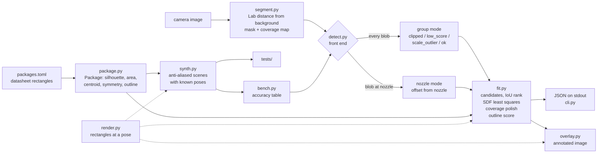
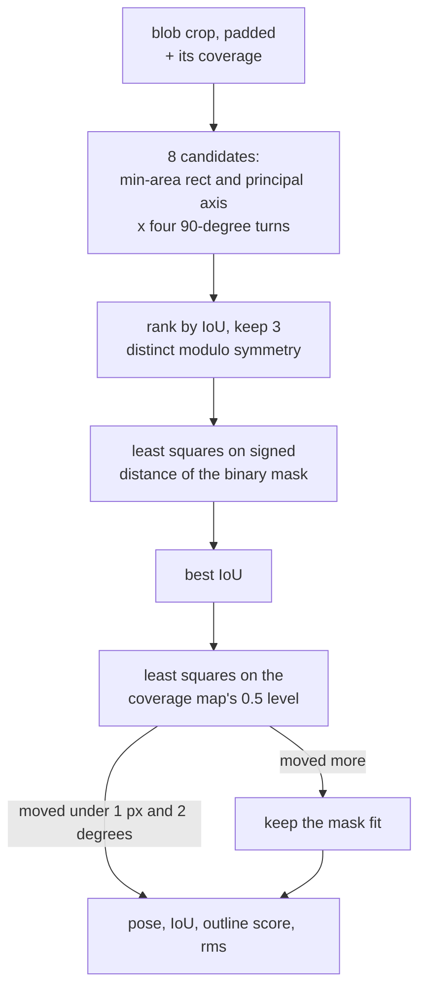

# Architecture

`render.py` is the one place rectangles become pixels, so the fit's IoU and score masks, the synthetic scenes and the overlay all use the same geometry.

Per blob, inside `fit.fit_blob`:

